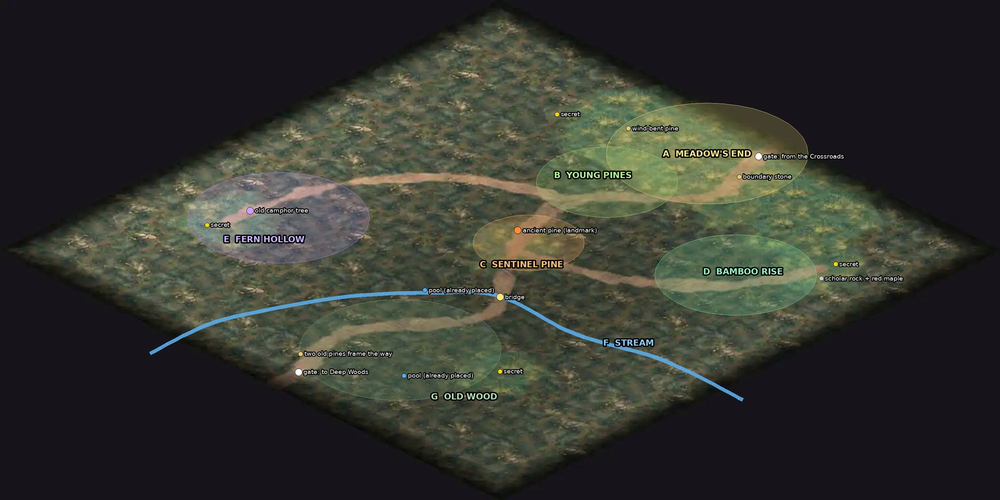

# Forest Edge: the plan and the pieces to paint

Step 1 of dressing the open world (docs/world.md, docs/environment.md): Forest Edge first, one map at a time.
Nothing is placed on the land until SHOAIB's new pictures are in. The old environment pieces (`rock_small_01`,
`boulder_01`, `stones_cluster_01`, `fern_01`, `grass_01`, `flowers_01`, `mushroom_01`) stay on the hunting map but are
**not** used here, because their style doesn't match the town (see "Why the old pieces didn't fit" below). The two pools and the two
mossy rocks already on the land (web/scenery.py) stay where they are.



## The idea

You leave the Crossroads' meadow and the forest closes in around you, step by step. Open grass and single trees at
the gate, then young pines, then a clearing under one huge old pine, a bridge over a stream, and a darker old wood
where the road goes on to Deep Woods. Each zone has **one landmark** you can steer by and its own mood, so no two
parts look alike.

| Zone | Where (tiles) | Mood | Landmark | Mostly |
|---|---|---|---|---|
| **A. Meadow's End** | the north gate (40, 4) to y 12 | open, bright, windy | the **boundary stone** beside the road just inside the gate; a **wind-bent pine** alone on the rise to the west (27, 9) | grass tufts, wildflowers, 2-3 young pines in small groups, lots of open ground |
| **B. Young Pines** | y 12 to 26 along the road | the trees begin | the mossy rock (already placed, 29, 17) | young pines in groups of 2-4, bushes, ferns at their feet; a nook of azaleas round the secret spot (20, 12) |
| **C. Sentinel Pine** | the fork (36, 34) | a resting place | the **ancient pine** on the clearing's north side (33.5, 31): its long arm reaches over the road, so you walk under it | a stump and a log to sit on, ferns, flowers in the clearing's grass |
| **D. Bamboo Rise** | the east path to the far clearing (60, 15) | green, tall, quiet | the **scholar rock** and one **red maple** in the far clearing (secret spot) | bamboo walls on both sides of the path, opening into the clearing |
| **E. Fern Hollow** | the west path's end (12, 50) | damp, dark, overgrown | the **old camphor tree** (12, 47) | ferns, a dead snag, fallen logs, red spider lilies, rocks; the secret spot (11, 52) under it |
| **F. The Stream** | from the east edge, under the road, through the pool (35.4, 45.9), out by the south-west edge | cool, moving water | the **wooden bridge** where the road crosses (41.5, 41.5) | reeds and rocks on the banks |
| **G. Old Wood** | y 45 to the south gate (38, 66) | deeper, older | **two old pines framing the road** like a gate before Deep Woods (35.6, 63.5) | big pines, the camphor-type trees, fewer flowers, the second pool (45.9, 59.3) with reeds; the secret clearing (52, 52) |

### Placing rules (step 3)

- **Hand-placed, in groups**, never scattered: trees in clusters of 2-4 with a big one and smaller ones, bushes and
  ferns at their feet, then open ground. About 40% of each zone stays bare ground so it breathes.
- **No repetition you can see:** the same picture is never next to itself at the same size and facing; variety from
  size (0.8-1.2), mirroring and the variants.
- **Trunks at least 2 tiles from the road**; crowns may hang over it. Only the trunk blocks you (a small circle), so you
  walk **behind** crowns and the hero's silhouette shows through (town.js already does this for tall pieces).
- Gates, the far clearings (herbs and finds use them) and a wide way round the pools stay clear (tests check it).
- About 110-140 pieces in all on this 70 x 70 land.
- **The stream** is painted into the ground (a new water ground in scripts/make_land.py, using the water texture below)
  and blocks you along its length except on the bridge. The road is nudged near the bridge so it crosses the stream
  straight, along the bridge's direction.

## Why the old pieces didn't fit

The town's pictures (the pine, bush and boulders in `forest_edge_reference.png`) have **thin dark-brown ink outlines,
warm muted earthy colours and a clear look down from above** (you see the top of the base). The older forest pieces are
smooth, cool grey and teal, with no outlines, and are drawn more from the side. The prompts below all start from the
same reference picture and spell those three things out.

## How to make each picture

- **Attach `docs/maps/forest_edge_reference.png` to every prompt** (the town pine, a hero for size, the town bush and
  boulders). The prompt tells Gemini to copy its style, colours, light and camera, **but not its square patch of
  ground**.
- Use the aspect ratio given for each piece. Green things go on light grey `#B0B0B0`, the rest on grey-green `#7A8476`
  (the cutting script keys those out).
- One object per picture. If a picture comes out with a ground patch, a shadow, a glow or a gradient background, send
  it anyway: I'll clean what I can and only ask for a re-roll when it can't be fixed.
- The size in the game is set in code (the "Drawn" column), so the prompt only says how big it is next to the hero, so
  the amount of detail is right.

## The pieces (24)

Names are the file names to save them as (`.png`). "Drawn" is its height in the game (the hero is about 128),
"Blocks" the circle round its foot that you can't walk through.

| # | Name | What | Ratio | Back | Drawn | Blocks |
|---|---|---|---|---|---|---|
| 1 | `fe_pine_young_01` | young pine, tiered | 3:4 | `#B0B0B0` | 420 | 0.35 |
| 2 | `fe_pine_young_02` | young pine, bushy | 3:4 | `#B0B0B0` | 340 | 0.3 |
| 3 | `fe_pine_ancient_01` | **landmark** ancient pine | 1:1 | `#B0B0B0` | 700 | 0.8 |
| 4 | `fe_pine_windbent_01` | wind-bent old pine | 1:1 | `#B0B0B0` | 480 | 0.45 |
| 5 | `fe_tree_camphor_01` | **landmark** ancient broadleaf | 1:1 | `#B0B0B0` | 640 | 0.9 |
| 6 | `fe_maple_01` | red maple | 3:4 | `#7A8476` | 420 | 0.35 |
| 7 | `fe_tree_dead_01` | dead snag | 3:4 | `#7A8476` | 380 | 0.4 |
| 8 | `fe_stump_01` | old stump | 1:1 | `#7A8476` | 80 | 0.45 |
| 9 | `fe_bamboo_01` | tall bamboo clump | 9:16 | `#B0B0B0` | 540 | 0.6 |
| 10 | `fe_bamboo_02` | young bamboo clump | 3:4 | `#B0B0B0` | 260 | 0.35 |
| 11 | `fe_bush_01` | low spreading shrub | 1:1 | `#B0B0B0` | 100 | 0.5 |
| 12 | `fe_azalea_01` | flowering azalea | 1:1 | `#B0B0B0` | 120 | 0.5 |
| 13 | `fe_fern_01` | fern clump | 1:1 | `#B0B0B0` | 80 | - |
| 14 | `fe_grass_01` | wild grass tuft | 1:1 | `#B0B0B0` | 60 | - |
| 15 | `fe_flowers_01` | wildflower patch | 1:1 | `#B0B0B0` | 34 | - |
| 16 | `fe_spiderlily_01` | red spider lilies | 1:1 | `#B0B0B0` | 56 | - |
| 17 | `fe_reeds_01` | reeds and cattails | 1:1 | `#B0B0B0` | 110 | 0.3 |
| 18 | `fe_rock_01` | mossy rock | 1:1 | `#7A8476` | 70 | 0.45 |
| 19 | `fe_rocks_flat_01` | sunken flat stones | 16:9 | `#7A8476` | 50 | 0.6 |
| 20 | `fe_scholar_rock_01` | **landmark** scholar rock | 3:4 | `#7A8476` | 230 | 0.7 |
| 21 | `fe_log_01` | fallen pine log | 16:9 | `#7A8476` | 380 long | along it |
| 22 | `fe_bridge_01` | **landmark** wooden bridge | 16:9 | `#7A8476` | 360 long | its rails |
| 23 | `fe_water_tex` | stream water texture | 1:1 | (none) | - | - |
| 24 | `fe_boundary_stone_01` | **landmark** boundary stone | 3:4 | `#7A8476` | 170 | 0.5 |

**Suggested order:** the trees first (1-5, 9), since they shape the map and are the hardest to get right. Then the rest.
Send them in any batches; I build zone by zone as they come.

### The prompts

Every prompt is complete: paste it as it is, with the reference picture attached.

**1. `fe_pine_young_01`** (3:4)
```
A single young Chinese black pine tree, as a game asset. Use the attached picture as the reference for art style, colours, lighting and camera angle: hand-painted 2D game art for a Chinese xianxia isometric MMORPG, thin dark-brown ink outlines, soft painterly shading, muted earthy colours (olive and moss green, warm umber, stone grey), soft daylight from the upper left. Same camera as the reference: isometric, looking down at about 35 degrees, no perspective distortion. The tree: a slender straight trunk with a slight lean, five separate tiers of flat, layered needle pads with clear gaps between the tiers so you can see through them, a few roots showing at its foot. It is about 3 times as tall as the small woman in the reference. Do NOT copy the reference's square patch of ground: the tree stands on nothing and ends where its roots meet the ground. No cast shadow, no grass or soil under it. Nothing glows. Only this one tree, centred, with wide empty margins; nothing touches the picture's edges. Background: one flat even light grey #B0B0B0, no gradient, no texture, no vignette, no text.
```

**2. `fe_pine_young_02`** (3:4)
```
A single young Chinese pine tree, shorter and bushier, as a game asset. Use the attached picture as the reference for art style, colours, lighting and camera angle: hand-painted 2D game art for a Chinese xianxia isometric MMORPG, thin dark-brown ink outlines, soft painterly shading, muted earthy colours (olive and moss green, warm umber, stone grey), soft daylight from the upper left. Same camera as the reference: isometric, looking down at about 35 degrees, no perspective distortion. The tree: a trunk curving gently to the left, a dense rounded crown of needle clusters at the top, two broken branch stubs low on the trunk, roots showing at its foot. It looks clearly different from the reference pine. It is about 2.5 times as tall as the small woman in the reference. Do NOT copy the reference's square patch of ground: the tree stands on nothing and ends where its roots meet the ground. No cast shadow, no grass or soil under it. Nothing glows. Only this one tree, centred, with wide empty margins; nothing touches the picture's edges. Background: one flat even light grey #B0B0B0, no gradient, no texture, no vignette, no text.
```

**3. `fe_pine_ancient_01`** (1:1)
```
A single huge ancient Chinese pine tree, like the famous welcoming pine of Huangshan, as a game asset. Use the attached picture as the reference for art style, colours, lighting and camera angle: hand-painted 2D game art for a Chinese xianxia isometric MMORPG, thin dark-brown ink outlines, soft painterly shading, muted earthy colours (olive and moss green, warm umber, stone grey), soft daylight from the upper left. Same camera as the reference: isometric, looking down at about 35 degrees, no perspective distortion. The tree: a massive, very thick gnarled trunk twisting upward, deeply furrowed bark, one long horizontal branch reaching far out to the left like an outstretched arm, a wide crown of flat cloud-like layers of needles, thick roots gripping the ground like claws with moss on them. It looks hundreds of years old and majestic. It is about 5 times as tall as the small woman in the reference and very wide. Do NOT copy the reference's square patch of ground: the tree stands on nothing and ends where its roots meet the ground. No cast shadow, no grass or soil under it. Nothing glows. Only this one tree, centred, with wide empty margins; nothing touches the picture's edges, including the long branch. Background: one flat even light grey #B0B0B0, no gradient, no texture, no vignette, no text.
```

**4. `fe_pine_windbent_01`** (1:1)
```
A single old pine tree bent by the wind, as a game asset. Use the attached picture as the reference for art style, colours, lighting and camera angle: hand-painted 2D game art for a Chinese xianxia isometric MMORPG, thin dark-brown ink outlines, soft painterly shading, muted earthy colours (olive and moss green, warm umber, stone grey), soft daylight from the upper left. Same camera as the reference: isometric, looking down at about 35 degrees, no perspective distortion. The tree: the trunk leans strongly to the right in an S-shaped curve, all its branches and flat needle pads stream out to the right as if shaped by years of wind, a sparse crown with a few bare branch tips, roots showing at its foot. It is about 3.5 times as tall as the small woman in the reference. Do NOT copy the reference's square patch of ground: the tree stands on nothing and ends where its roots meet the ground. No cast shadow, no grass or soil under it. Nothing glows. Only this one tree, centred, with wide empty margins; nothing touches the picture's edges. Background: one flat even light grey #B0B0B0, no gradient, no texture, no vignette, no text.
```

**5. `fe_tree_camphor_01`** (1:1)
```
A single enormous ancient camphor tree (a broadleaf tree), as a game asset. Use the attached picture as the reference for art style, colours, lighting and camera angle: hand-painted 2D game art for a Chinese xianxia isometric MMORPG, thin dark-brown ink outlines, soft painterly shading, muted earthy colours (olive and moss green, warm umber, stone grey), soft daylight from the upper left. Same camera as the reference: isometric, looking down at about 35 degrees, no perspective distortion. The tree: a short, enormously thick trunk that splits into three heavy limbs, a dark hollow in the trunk, a huge rounded crown made of dense clumps of dark green leaves, knotted roots spreading out from the base with moss and a few small ferns in the gaps between them. It feels old, dark and quiet. It is about 4.5 times as tall as the small woman in the reference, and its crown is very wide. Do NOT copy the reference's square patch of ground: the tree stands on nothing and ends where its roots meet the ground. No cast shadow, no grass or soil under it. Nothing glows. Only this one tree, centred, with wide empty margins; nothing touches the picture's edges. Background: one flat even light grey #B0B0B0, no gradient, no texture, no vignette, no text.
```

**6. `fe_maple_01`** (3:4)
```
A single Chinese maple tree in autumn, as a game asset. Use the attached picture as the reference for art style, colours, lighting and camera angle: hand-painted 2D game art for a Chinese xianxia isometric MMORPG, thin dark-brown ink outlines, soft painterly shading, muted earthy colours, soft daylight from the upper left. Same camera as the reference: isometric, looking down at about 35 degrees, no perspective distortion. The tree: a slim, graceful dark trunk that forks twice, an airy crown of maple leaves in warm rust red and deep orange (muted, painterly, not neon), with gaps of open space between the leaf clusters, roots showing at its foot. It is about 3 times as tall as the small woman in the reference. Do NOT copy the reference's square patch of ground: the tree stands on nothing and ends where its roots meet the ground. No fallen leaves, no cast shadow, no grass or soil under it. Nothing glows. Only this one tree, centred, with wide empty margins; nothing touches the picture's edges. Background: one flat even grey-green #7A8476, no gradient, no texture, no vignette, no text.
```

**7. `fe_tree_dead_01`** (3:4)
```
A single dead old tree, as a game asset. Use the attached picture as the reference for art style, colours, lighting and camera angle: hand-painted 2D game art for a Chinese xianxia isometric MMORPG, thin dark-brown ink outlines, soft painterly shading, muted earthy colours, soft daylight from the upper left. Same camera as the reference: isometric, looking down at about 35 degrees, no perspective distortion. The tree: a weathered silver-grey bare trunk with no leaves, its top broken off in a jagged point, three bare twisted branches, two brown bracket fungi growing on the trunk, a little moss at its base, roots showing. It is about 3 times as tall as the small woman in the reference. Do NOT copy the reference's square patch of ground: the tree stands on nothing and ends where its roots meet the ground. No cast shadow, no grass or soil under it. Nothing glows. Only this one tree, centred, with wide empty margins; nothing touches the picture's edges. Background: one flat even grey-green #7A8476, no gradient, no texture, no vignette, no text.
```

**8. `fe_stump_01`** (1:1)
```
A single old tree stump, as a game asset. Use the attached picture as the reference for art style, colours, lighting and camera angle: hand-painted 2D game art for a Chinese xianxia isometric MMORPG, thin dark-brown ink outlines, soft painterly shading, muted earthy colours, soft daylight from the upper left. Same camera as the reference: isometric, looking down at about 35 degrees, so we see the stump's flat cut top with its growth rings from above. The stump: wide and low, rough bark, roots spreading out from it, moss on one side, a small cluster of tiny brown mushrooms at its foot. It is about knee-high to the small woman in the reference. Do NOT copy the reference's square patch of ground: the stump stands on nothing and ends where its roots meet the ground. No cast shadow, no grass or soil under it. Nothing glows. Only this one stump, centred, with wide empty margins; nothing touches the picture's edges. Background: one flat even grey-green #7A8476, no gradient, no texture, no vignette, no text.
```

**9. `fe_bamboo_01`** (9:16)
```
A single tall clump of bamboo, as a game asset. Use the attached picture as the reference for art style, colours, lighting and camera angle: hand-painted 2D game art for a Chinese xianxia isometric MMORPG, thin dark-brown ink outlines, soft painterly shading, muted earthy colours (olive and jade green, warm umber), soft daylight from the upper left. Same camera as the reference: isometric, looking down at about 35 degrees, no perspective distortion. The clump: about fourteen green bamboo stalks of different heights growing from one compact base, the tallest gently bending at the top, dark rings at the nodes, narrow leaves in drooping sprays near the top and along the upper stalks, a few yellowed lower leaves. It is about 4 times as tall as the small woman in the reference. Do NOT copy the reference's square patch of ground: the clump stands on nothing and ends where the stalks meet the ground. No cast shadow, no fallen leaves, no grass or soil under it. Nothing glows. Only this one clump, centred, with wide empty margins; nothing touches the picture's edges, including the tops. Background: one flat even light grey #B0B0B0, no gradient, no texture, no vignette, no text.
```

**10. `fe_bamboo_02`** (3:4)
```
A single small young clump of bamboo, as a game asset. Use the attached picture as the reference for art style, colours, lighting and camera angle: hand-painted 2D game art for a Chinese xianxia isometric MMORPG, thin dark-brown ink outlines, soft painterly shading, muted earthy colours (olive and jade green, warm umber), soft daylight from the upper left. Same camera as the reference: isometric, looking down at about 35 degrees, no perspective distortion. The clump: five slender young bamboo stalks with leaf sprays at their tops, and three short new bamboo shoots in brown sheaths at the base. It is about 2 times as tall as the small woman in the reference. Do NOT copy the reference's square patch of ground: the clump stands on nothing and ends where the stalks meet the ground. No cast shadow, no fallen leaves, no grass or soil under it. Nothing glows. Only this one clump, centred, with wide empty margins; nothing touches the picture's edges. Background: one flat even light grey #B0B0B0, no gradient, no texture, no vignette, no text.
```

**11. `fe_bush_01`** (1:1)
```
A single low, spreading forest shrub, as a game asset. Use the attached picture as the reference for art style, colours, lighting and camera angle: hand-painted 2D game art for a Chinese xianxia isometric MMORPG, thin dark-brown ink outlines, soft painterly shading, muted earthy colours, soft daylight from the upper left. Same camera as the reference: isometric, looking down at about 35 degrees, so we see the top of the shrub from above. The shrub: wider than it is tall, an irregular uneven outline, many small dark-green glossy leaves with a few olive and bronze ones, a few woody stems visible at its base. It looks clearly different from the reference bush (smaller leaves, lower and flatter). It is about knee-high to waist-high on the small woman in the reference. Do NOT copy the reference's square patch of ground: the shrub stands on nothing and ends where its stems meet the ground. No cast shadow, no grass or soil under it. Nothing glows. Only this one shrub, centred, with wide empty margins; nothing touches the picture's edges. Background: one flat even light grey #B0B0B0, no gradient, no texture, no vignette, no text.
```

**12. `fe_azalea_01`** (1:1)
```
A single flowering mountain azalea shrub, as a game asset. Use the attached picture as the reference for art style, colours, lighting and camera angle: hand-painted 2D game art for a Chinese xianxia isometric MMORPG, thin dark-brown ink outlines, soft painterly shading, muted earthy colours, soft daylight from the upper left. Same camera as the reference: isometric, looking down at about 35 degrees, so we see the top of the shrub from above. The shrub: rounded, dark green leaves, covered in clusters of soft pink-magenta azalea blossoms (muted, painterly, not neon), a few woody stems visible at its base. It is about waist-high on the small woman in the reference. Do NOT copy the reference's square patch of ground: the shrub stands on nothing and ends where its stems meet the ground. No fallen petals, no cast shadow, no grass or soil under it. Nothing glows. Only this one shrub, centred, with wide empty margins; nothing touches the picture's edges. Background: one flat even light grey #B0B0B0, no gradient, no texture, no vignette, no text.
```

**13. `fe_fern_01`** (1:1)
```
A single clump of forest ferns, as a game asset. Use the attached picture as the reference for art style, colours, lighting and camera angle: hand-painted 2D game art for a Chinese xianxia isometric MMORPG, thin dark-brown ink outlines, soft painterly shading, muted earthy colours (olive and deep moss green, a little warm brown), soft daylight from the upper left. Same camera as the reference: isometric, looking down at about 35 degrees, so we see the clump from above. The clump: eight to ten fern fronds arching outward from one centre, mostly olive and deep green, two older fronds turning brown at the tips. Not bright, not teal. It is about knee-high on the small woman in the reference. Do NOT copy the reference's square patch of ground: the ferns stand on nothing and end where they meet the ground; no bare roots. No cast shadow, no grass or soil under it. Nothing glows. Only this one clump, centred, with wide empty margins; nothing touches the picture's edges. Background: one flat even light grey #B0B0B0, no gradient, no texture, no vignette, no text.
```

**14. `fe_grass_01`** (1:1)
```
A single tuft of tall wild grass, as a game asset. Use the attached picture as the reference for art style, colours, lighting and camera angle: hand-painted 2D game art for a Chinese xianxia isometric MMORPG, thin dark-brown ink outlines, soft painterly shading, muted earthy colours (olive green and dry straw yellow), soft daylight from the upper left. Same camera as the reference: isometric, looking down at about 35 degrees. The tuft: a dense clump of long grass blades bending outward in different directions, a few taller stems with feathery seed heads, some blades dry and straw-coloured. It is about knee-high on the small woman in the reference. Do NOT copy the reference's square patch of ground: the grass stands on nothing and ends where it meets the ground. No cast shadow, no soil under it. Nothing glows. Only this one tuft, centred, with wide empty margins; nothing touches the picture's edges. Background: one flat even light grey #B0B0B0, no gradient, no texture, no vignette, no text.
```

**15. `fe_flowers_01`** (1:1)
```
A single small patch of wildflowers, as a game asset. Use the attached picture as the reference for art style, colours, lighting and camera angle: hand-painted 2D game art for a Chinese xianxia isometric MMORPG, thin dark-brown ink outlines, soft painterly shading, muted earthy colours, soft daylight from the upper left. Same camera as the reference: isometric, looking down at about 35 degrees, so we see the patch from above. The patch: a loose cluster of small wildflowers on thin stems with a few leaves: mostly small white and pale yellow blossoms with three or four small blue ones. Soft colours, not bright. It is about ankle-high on the small woman in the reference. Do NOT copy the reference's square patch of ground: the flowers stand on nothing and end where their stems meet the ground. No cast shadow, no grass or soil under them. Nothing glows. Only this one patch, centred, with wide empty margins; nothing touches the picture's edges. Background: one flat even light grey #B0B0B0, no gradient, no texture, no vignette, no text.
```

**16. `fe_spiderlily_01`** (1:1)
```
A single small cluster of red spider lilies, as a game asset. Use the attached picture as the reference for art style, colours, lighting and camera angle: hand-painted 2D game art for a Chinese xianxia isometric MMORPG, thin dark-brown ink outlines, soft painterly shading, muted earthy colours, soft daylight from the upper left. Same camera as the reference: isometric, looking down at about 35 degrees. The cluster: five red spider lilies on tall bare green stems of slightly different heights, each flower with curled-back deep crimson petals and long thin curved stamens, no leaves. Deep, slightly muted red, not neon. It is about knee-high on the small woman in the reference. Do NOT copy the reference's square patch of ground: the lilies stand on nothing and end where their stems meet the ground. No cast shadow, no grass or soil under them. Nothing glows. Only this one cluster, centred, with wide empty margins; nothing touches the picture's edges. Background: one flat even light grey #B0B0B0, no gradient, no texture, no vignette, no text.
```

**17. `fe_reeds_01`** (1:1)
```
A single clump of reeds and cattails that grows at the edge of water, as a game asset. Use the attached picture as the reference for art style, colours, lighting and camera angle: hand-painted 2D game art for a Chinese xianxia isometric MMORPG, thin dark-brown ink outlines, soft painterly shading, muted earthy colours (olive green, straw, warm brown), soft daylight from the upper left. Same camera as the reference: isometric, looking down at about 35 degrees. The clump: tall thin reed leaves rising from one base, some bending over, and three brown cattail heads on straight stems. It is about as tall as the small woman's shoulders in the reference. Do NOT copy the reference's square patch of ground: the reeds stand on nothing and end where they meet the ground. No water, no cast shadow, no soil under them. Nothing glows. Only this one clump, centred, with wide empty margins; nothing touches the picture's edges. Background: one flat even light grey #B0B0B0, no gradient, no texture, no vignette, no text.
```

**18. `fe_rock_01`** (1:1)
```
A single medium-sized weathered rock, as a game asset. Use the attached picture as the reference for art style, colours, lighting and camera angle: hand-painted 2D game art for a Chinese xianxia isometric MMORPG, thin dark-brown ink outlines, soft painterly shading, muted earthy colours (warm stone grey, moss green, ochre lichen), soft daylight from the upper left. Same camera as the reference: isometric, looking down at about 35 degrees, so we see the top of the rock from above. The rock: one rounded, slightly flat-topped stone with cracks, patches of moss on its top and ochre lichen on its side, three small pebbles touching its foot. It matches the stones in the reference's boulders. It is about knee-high on the small woman in the reference. Do NOT copy the reference's square patch of ground: the rock sits on nothing and ends where it meets the ground. No cast shadow, no grass or soil under it, no pale outline along its edges. Nothing glows. Only this one rock, centred, with wide empty margins; nothing touches the picture's edges. Background: one flat even grey-green #7A8476, no gradient, no texture, no vignette, no text.
```

**19. `fe_rocks_flat_01`** (16:9)
```
A small group of three flat stone slabs half sunk into the ground, as a game asset. Use the attached picture as the reference for art style, colours, lighting and camera angle: hand-painted 2D game art for a Chinese xianxia isometric MMORPG, thin dark-brown ink outlines, soft painterly shading, muted earthy colours (warm stone grey, moss green), soft daylight from the upper left. Same camera as the reference: isometric, looking down at about 35 degrees, so we mostly see the slabs' flat tops from above. The group: three low, flat, weathered stone slabs of different sizes lying close together, with moss along their edges and in their cracks. They are about ankle-high on the small woman in the reference. Do NOT copy the reference's square patch of ground: the stones sit on nothing and end where they meet the ground. No cast shadow, no grass or soil around them, no pale outline along their edges. Nothing glows. Only this one group, centred, with wide empty margins; nothing touches the picture's edges. Background: one flat even grey-green #7A8476, no gradient, no texture, no vignette, no text.
```

**20. `fe_scholar_rock_01`** (3:4)
```
A single tall Chinese scholar rock (a Taihu limestone rock), as a game asset. Use the attached picture as the reference for art style, colours, lighting and camera angle: hand-painted 2D game art for a Chinese xianxia isometric MMORPG, thin dark-brown ink outlines, soft painterly shading, muted earthy colours (pale warm grey stone, moss green), soft daylight from the upper left. Same camera as the reference: isometric, looking down at about 35 degrees, no perspective distortion. The rock: a tall upright pale grey limestone rock, slightly twisted, deeply eroded with several holes and hollows that go right through it, rough wrinkled surface, moss in its lower hollows and one small fern growing from a crevice. It looks ancient and elegant. It is about 1.8 times as tall as the small woman in the reference. Do NOT copy the reference's square patch of ground: the rock stands on nothing and ends where it meets the ground. No pedestal, no cast shadow, no grass or soil under it. Nothing glows. The holes show the flat background colour through them. Only this one rock, centred, with wide empty margins; nothing touches the picture's edges. Background: one flat even grey-green #7A8476, no gradient, no texture, no vignette, no text.
```

**21. `fe_log_01`** (16:9)
```
A single long fallen pine log lying on the ground, as a game asset. Use the attached picture as the reference for art style, colours, lighting and camera angle: hand-painted 2D game art for a Chinese xianxia isometric MMORPG, thin dark-brown ink outlines, soft painterly shading, muted earthy colours (warm brown bark, moss green), soft daylight from the upper left. Same camera as the reference: isometric, looking down at about 35 degrees. The log lies diagonally from the lower left of the picture to the upper right, following the isometric grid. Thick old bark peeling in places, a line of moss along its top, one short broken branch stub sticking up, the near end broken and splintered, the far end with a few dead roots. It is about 3 times as long as the small woman in the reference is tall. Do NOT copy the reference's square patch of ground: the log lies on nothing. No cast shadow, no grass or soil under it, no blue tint. Nothing glows. Only this one log, centred, with wide empty margins; nothing touches the picture's edges. Background: one flat even grey-green #7A8476, no gradient, no texture, no vignette, no text.
```

**22. `fe_bridge_01`** (16:9)
```
A single small old wooden footbridge, as a game asset. Use the attached picture as the reference for art style, colours, lighting and camera angle: hand-painted 2D game art for a Chinese xianxia isometric MMORPG, thin dark-brown ink outlines, soft painterly shading, muted earthy colours (weathered grey-brown wood, moss green, stone grey), soft daylight from the upper left. Same camera as the reference: isometric, looking down at about 35 degrees, so we see the top of the plank deck. The bridge runs diagonally from the lower left of the picture to the upper right, following the isometric grid. A gently arched deck of wooden planks, a simple wooden railing on both sides with square posts, a little moss on the rails, and a short stone footing at each end. It is wide enough for one person to walk across, about 3 times as long as the small woman in the reference is tall. Nothing underneath it: no water, no stream, no riverbanks, no ground. No cast shadow. Nothing glows. Only this one bridge, centred, with wide empty margins; nothing touches the picture's edges. Background: one flat even grey-green #7A8476, no gradient, no texture, no vignette, no text.
```

**23. `fe_water_tex`** (1:1, no reference needed but it doesn't hurt)
```
A seamless, tileable square texture of shallow clear forest stream water seen from straight above, for a hand-painted 2D game. Painterly style with thin dark ink touches like hand-painted RPG ground textures, muted colours: dark teal-green water with smooth rounded pebbles and a few larger stones visible on the stream bed through the water, soft light ripples on the surface. The texture fills the whole picture edge to edge and repeats seamlessly on all four sides. Even lighting across the whole picture: no light spot, no vignette, no gradient. No banks, no plants, no leaves, no fish, no reflections of trees, no objects, no text.
```

**24. `fe_boundary_stone_01`** (3:4)
```
A single old boundary stone, as a game asset. Use the attached picture as the reference for art style, colours, lighting and camera angle: hand-painted 2D game art for a Chinese xianxia isometric MMORPG, thin dark-brown ink outlines, soft painterly shading, muted earthy colours (warm grey stone, moss green, faded red), soft daylight from the upper left. Same camera as the reference: isometric, looking down at about 35 degrees, no perspective distortion. The stone: an upright weathered stone slab with a rounded top, standing on a small square stone base, its front face blank and worn smooth (no writing, no letters, no characters), moss and lichen on its edges, and a faded red cloth tied round it with the ends hanging down. It is about 1.3 times as tall as the small woman in the reference. Do NOT copy the reference's square patch of ground: the stone stands on nothing and ends at the bottom of its base. No cast shadow, no grass or soil under it. Nothing glows. Only this one stone, centred, with wide empty margins; nothing touches the picture's edges. Background: one flat even grey-green #7A8476, no gradient, no texture, no vignette, no text.
```

## What comes after the pictures

1. **Check each picture** (camera angle, size, flat background, no ground patch, no shadow, the sparkle to remove);
   clean what can be fixed; ask for a re-roll only when it can't be.
2. **Cut them** (`scripts/make_env_assets.py`) into `art/env/forest_edge/...` and add them to `web/env.py` `ASSETS`.
3. **The stream and the bridge:** water in the ground painter, its collision, the road nudged to cross on the bridge.
4. **Place the zones** by hand, A to G, in small PRs, each tested (pytest, headless shots on PC and phone).
